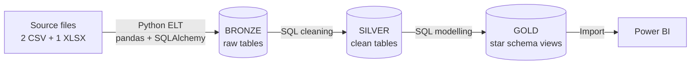
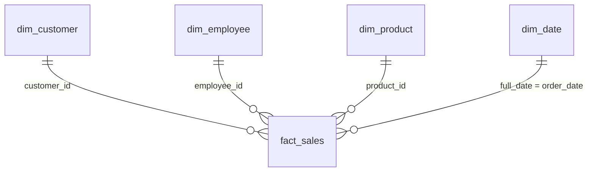

# DACK48 – Mini Project 2: Sales Data Pipeline (Python · PostgreSQL · Power BI)

End-to-end data pipeline for a Vietnamese FMCG distributor: raw files are loaded with **Python** into **PostgreSQL**, cleaned and modelled with **SQL** following the **Medallion Architecture** (Bronze → Silver → Gold), and served to **Power BI** as a **star schema**.

> Project for class DACK48 – module Python (UNIGAP).

---

## Architecture



| Layer | Object type | Content |
|---|---|---|
| **Bronze** | tables | Raw data loaded as-is + `ingestion_timestamp` |
| **Silver** | tables | Cleaned, correctly typed data + data-quality flags |
| **Gold** | views | Star schema (4 dimensions + 1 fact) ready for reporting |

---

## Tech stack
- **Python** – pandas, SQLAlchemy, psycopg2, python-dotenv, openpyxl
- **PostgreSQL** + **DBeaver**
- **Power BI Desktop**
- **Git / GitHub**

---

## Repository structure

```
├── Customer Master.csv          # source: 2,000 customers
├── Sales Transaction.csv        # source: 119,101 order lines (year 2024)
├── Employee.xlsx                # source: 114 employees
├── ELT/                         # Python: source files -> bronze
│   ├── 1_Customer_Master_ELT.py
│   ├── 2_Sales_Transaction_ELT.py
│   └── 3_Employee_ELT.py
├── sql/
│   ├── silver/                  # SQL: bronze -> silver (cleaning)
│   │   ├── 01_silver_customer.sql
│   │   ├── 02_silver_employee.sql
│   │   └── 03_silver_sales.sql
│   └── gold/                    # SQL: silver -> gold (star schema views)
│       ├── 01_dim_customer.sql
│       ├── 02_dim_employee.sql
│       ├── 03_dim_product.sql
│       ├── 04_dim_date.sql
│       └── 05_fact_sales.sql
├── powerbi/
│   └── Project 2 - Python.pbix  # Power BI file connected to the gold layer
└── .gitignore                   # excludes .env (database credentials)
```

Every SQL file is written as a **step-by-step notebook**:
**A. Explore → B. Test → C. Create → D. Validate**, and each query is followed by its `-- Outcome:` (result + decision), so the reasoning behind every transformation is documented.

---

## How to run

### 1. Prerequisites
- PostgreSQL running locally, with 3 schemas: `bronze`, `silver`, `gold`
- Python packages:
  ```bash
  pip install pandas sqlalchemy psycopg2-binary python-dotenv openpyxl
  ```
- A `.env` file in the project root (not committed):
  ```
  DB_HOST=localhost
  DB_PORT=5432
  DB_USER=<your_user>
  DB_PASSWORD=<your_password>
  DB_NAME=<your_database>
  ```

### 2. Bronze – load the raw files
```bash
python ELT/1_Customer_Master_ELT.py
python ELT/2_Sales_Transaction_ELT.py
python ELT/3_Employee_ELT.py
```
Creates `bronze."Raw_Customer"`, `bronze."Raw_Sales"`, `bronze."Raw_Employee"`.

> ⚠️ The scripts use `if_exists="append"` and absolute file paths (as instructed in class). Run each script **only once**; re-running duplicates the data. Update the file paths to your own machine before running.

### 3. Silver – clean the data
Run in DBeaver, **in this order**: `sql/silver/01` → `02` → `03` (03 uses the tables created by 01 and 02).

### 4. Gold – build the star schema
Run `sql/gold/01` → `05`.

> ⚠️ Gold views depend on silver tables. Re-running a silver script (`DROP TABLE ... CASCADE`) also drops the gold views → re-run the gold scripts afterwards.

### 5. Power BI
Open `powerbi/Project 2 - Python.pbix` (or connect a new report to PostgreSQL in **Import** mode and load the 5 `gold` views).

---

## Data model (Gold layer)



| View | Grain | Rows | Notes |
|---|---|---|---|
| `gold.fact_sales` | 1 product line in 1 order | 119,101 | keys, amounts, `recognized_revenue`, line status, DQ flags |
| `gold.dim_customer` | 1 customer | 2,000 | holds region / province / channel, `credit_limit_tier`, `join_year` |
| `gold.dim_employee` | 1 employee (latest version) | 114 | `age_group`, `tenure_group`, `employee_region` |
| `gold.dim_product` | 1 product | 92 | derived from sales (no product master), `price_tier` |
| `gold.dim_date` | 1 day | 366 | generated calendar for 2024 |

**Key design decisions**
- **Cancelled lines are kept** (to measure cancellation rate) but `recognized_revenue = 0` → use `recognized_revenue` for revenue, never `net_amount`.
- **Region = customer region.** Sales region / province / channel match the customer master 100%, so they live in `dim_customer`.
- **Delivery / payment status stay at line level**: within one order, lines can have different statuses.
- **`dim_employee` keeps only the latest version** of each employee (source is SCD Type 2) so Power BI gets a unique key.

---

## Data quality findings

The source data is clean in format (no NULLs in key columns, no duplicates, no orphan keys, amounts consistent), but several **business-logic issues** were found. Rows are **kept and flagged**, not deleted:

| Issue | Rows | Flag column |
|---|---|---|
| Line cancelled but marked as **Paid** | 3,570 lines | `flag_cancelled_but_paid` |
| Order placed **before the customer joined** | 638 lines (273 orders, 42 customers) | `flag_order_before_join` |
| Sale region ≠ employee region (3 employees from Miền Bắc) | 253 lines | `flag_region_mismatch_employee` |
| Employee **joined before 18 years old** | 8 employees | `flag_joined_under_18` |

Other cleaning steps: text dates → `DATE`, phone numbers → text with leading `0`, `tax_code` decimal → text (52% missing, kept as NULL + `has_tax_code`), defensive `TRIM()`, only the latest `ingestion_timestamp` is read from bronze.

Notes that are **not errors**: `discount_amount` is rounded to the nearest 100 VND (max 50 VND difference); 198 customers (all 157 inactive + 41 active) and 6 managers have no sales.

---

## Key figures (control totals)

| Metric | Value |
|---|---|
| Recognized revenue (excl. cancelled) | **152,528,806,100 VND** |
| Orders with at least one non-cancelled line | 49,420 |
| Cancellation rate (lines) | 4.03% |
| Top region | Miền Trung – 55.6B |
| Top category | Thức uống – 57.3B |
| Peak months | Jan (18.9B), Dec (16.7B) · lowest: Feb (8.7B) |

These totals are reproduced in `sql/gold/05_fact_sales.sql` (part D) and used to cross-check Power BI.

---

## Project status

- [x] 1. PostgreSQL + DBeaver setup, schemas `bronze` / `silver` / `gold`
- [x] 2. Load raw files into bronze (Python)
- [x] 3. Clean bronze → silver (SQL)
- [x] 4. Build star schema views in gold (SQL)
- [x] 5. Connect Power BI to the gold layer
- [x] 6. Version control on GitHub

**Possible next steps**
- Build the Power BI dashboard pages (Overview, Product, Customer & Channel, Sales Team, Data Quality) and DAX measures
- Make the ELT scripts re-runnable (`replace` or truncate before load) and use relative paths
- Add `requirements.txt`
